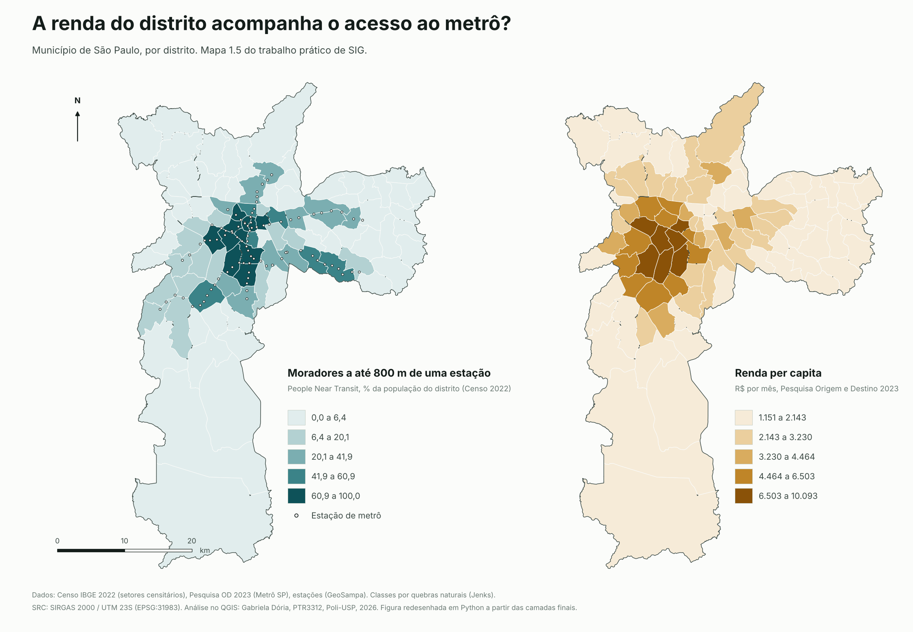
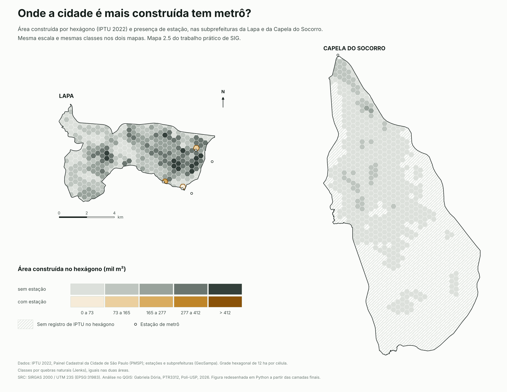
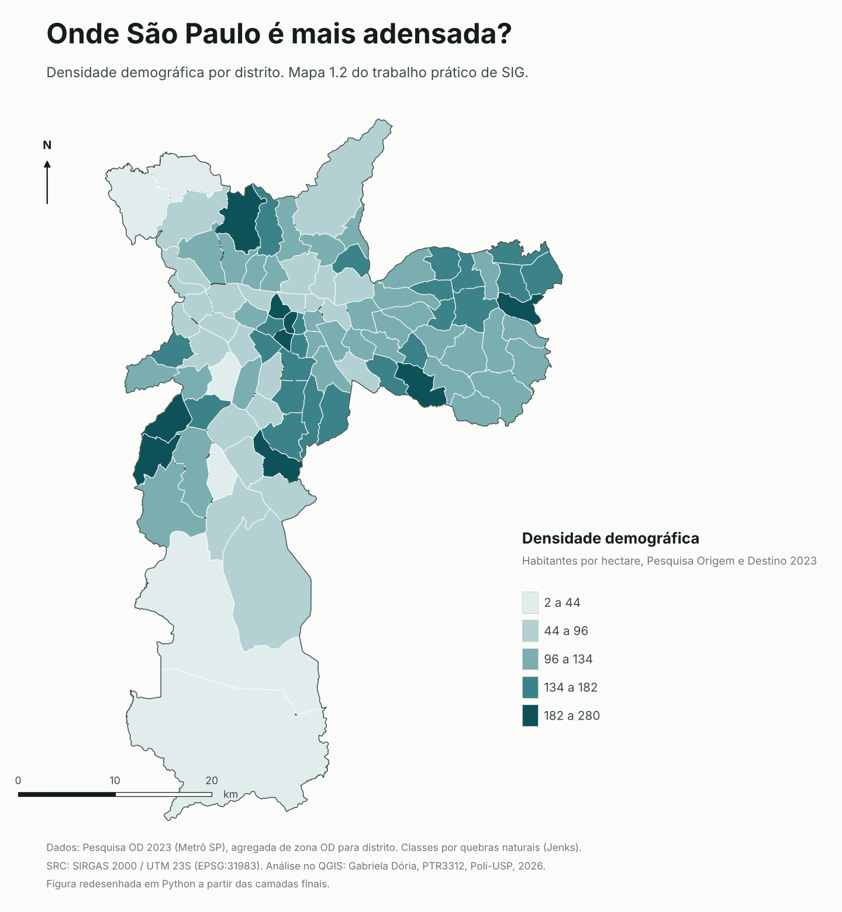
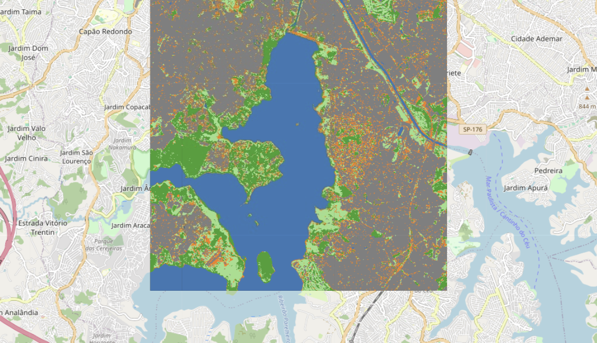

# Análise espacial no QGIS: metrô, renda e área construída em São Paulo

Mapas que produzi no trabalho prático de SIG da disciplina **PTR3312 Geoprocessamento para Engenharia Ambiental** (Poli-USP, 1º semestre de 2026). O trabalho foi feito em grupo de 3 pessoas. Este repositório reúne só os mapas de minha autoria, conforme a ficha do grupo.

**Ferramentas:** QGIS 3.44 (análise e mapas entregues), Python com geopandas (redesenho das figuras), Google Earth Engine (laboratórios de sensoriamento remoto).

## As três perguntas

| Mapa | Pergunta | Escala |
|---|---|---|
| 1.5 | A renda do distrito acompanha o acesso ao metrô? | Município, 96 distritos |
| 2.5 | Onde a cidade é mais construída tem metrô? | Lapa e Capela do Socorro, grade hexagonal |
| 1.2 | Onde São Paulo é mais adensada? | Município, 96 distritos |

## Mapa 1.5: renda e acesso ao metrô



O indicador é o *People Near Transit*: a parcela dos moradores de cada distrito que mora a até 800 m de uma estação de metrô.

**O que eu fiz no QGIS**

1. Reprojetei e corrigi a geometria das estações e dos setores censitários (SIRGAS 2000 / UTM 23S).
2. Juntei a tabela de população do Censo 2022 aos setores censitários (join por código do setor).
3. Gerei um buffer de 800 m em volta das 94 estações.
4. Cruzei o buffer com os setores (intersect) e estimei a população de cada fragmento pela proporção de área.
5. Somei a população por distrito (aggregate) e calculei o percentual sobre a população total.
6. Juntei a renda per capita por distrito, que eu já tinha agregado da Pesquisa OD 2023 no mapa 1.1.
7. Classifiquei as duas variáveis em 5 classes por quebras naturais (Jenks).

**O que o mapa mostra**

- Em 46 dos 96 distritos, nenhum morador está a até 800 m de uma estação.
- Em 11 distritos, mais de 60% dos moradores estão. Todos ficam no centro e no seu entorno.
- Dos 7 distritos na faixa mais alta de renda, 4 também estão na faixa mais alta de acesso: Pinheiros, Jardim Paulista, Consolação e Moema.
- A relação não é direta nos dois sentidos. Sé, República e Brás têm acesso alto e renda abaixo de R$ 3 mil. Morumbi e Alto de Pinheiros têm renda alta e menos de 20% dos moradores perto de uma estação.

**Limites**

- A população de cada fragmento supõe distribuição uniforme dentro do setor censitário.
- A camada tem só estações de metrô. Trem e corredor de ônibus ficaram fora.
- A distância é em linha reta, não pelo caminho a pé.

## Mapa 2.5: área construída e metrô



Comparo duas subprefeituras com as mesmas classes e a mesma escala: a Lapa, na zona oeste, e a Capela do Socorro, na zona sul.

**O que eu fiz no QGIS**

1. Recortei (clip) os lotes do IPTU 2022 pelo limite de cada subprefeitura e corrigi as geometrias.
2. Criei uma grade hexagonal de 12 ha por célula e recortei pelos limites.
3. Somei a área construída dos lotes em cada hexágono (join por localização com soma).
4. Contei as estações de metrô em cada hexágono (contagem de pontos em polígono).
5. Montei uma simbologia bivariada por regras: 5 faixas de área construída (Jenks) em cinza, e as mesmas 5 faixas em outra cor quando o hexágono tem estação.

**O que o mapa mostra**

- A Lapa soma 58,2 milhões de m² construídos em 397 hexágonos. A Capela do Socorro soma 17,5 milhões em 1.183.
- A Lapa tem 13 hexágonos na faixa mais alta. A Capela do Socorro não tem nenhum.
- Só 3 hexágonos da Lapa têm estação, e nenhum deles está na faixa mais alta. As estações ficam na borda da subprefeitura.
- A Capela do Socorro não tem estação de metrô dentro do limite.
- Em 662 dos 1.183 hexágonos da Capela do Socorro não há registro de IPTU. Eles se concentram na parte sul da subprefeitura.

## Mapa 1.2: densidade demográfica



Os dados da Pesquisa OD 2023 vêm por zona. Calculei a densidade (habitantes por hectare) na calculadora de campo, cruzei as zonas com os distritos (intersect) e agreguei por distrito pela média. Na mesma entrega fiz também o mapa 1.1 (renda per capita) e o 1.3 (taxa de motorização).

## Sensoriamento remoto



A segunda metade da disciplina teve cinco laboratórios guiados no Google Earth Engine, com Python no Google Colab: busca e metadados de imagens, composições e mosaicos sem nuvem, NDVI, classificação não supervisionada (k-means) e classificação supervisionada com avaliação por amostras de teste. A imagem é o resultado da minha classificação supervisionada de uma cena Sentinel-2 em volta da Represa Guarapiranga. Os roteiros são da disciplina e não estão neste repositório.

## O que tem aqui

```
mapas/                 figuras finais em português
mapas/en/              as mesmas figuras em inglês
mapas/originais-qgis/  os mapas como exportei do QGIS e entreguei
camadas/               camadas finais em GeoPackage (EPSG:31983)
scripts/               script que redesenha as figuras
sensoriamento-remoto/  resultado da classificação supervisionada
```

**Sobre as figuras.** A análise e os mapas entregues foram feitos no QGIS. Depois redesenhei as figuras em Python, lendo as camadas finais, para deixar a leitura mais limpa. As classes são as mesmas dos mapas entregues. Para refazer:

```
pip install geopandas matplotlib
python scripts/desenhar_mapas.py camadas mapas pt
```

**Sobre o uso de IA.** Usei o Claude como guia para montar a sequência de operações no QGIS e para escrever o script de redesenho. As operações, as decisões de método e a conferência dos resultados são minhas.

**O que ficou de fora.** Os dados brutos (lotes do IPTU, setores censitários, tabelas da OD) são grandes e públicos: os links estão abaixo. Os mapas dos outros integrantes do grupo também não estão aqui.

## Fontes dos dados

| Dado | Fonte |
|---|---|
| População por setor censitário, 2022 | [IBGE](https://www.ibge.gov.br), Censo Demográfico 2022, agregados por setor censitário |
| Renda, população e zonas, 2023 | Metrô de São Paulo, Pesquisa Origem e Destino 2023 |
| Estações de metrô e subprefeituras | [GeoSampa, Prefeitura de São Paulo](https://geosampa.prefeitura.sp.gov.br) |
| Área construída por lote, IPTU 2022 | Prefeitura de São Paulo, Painel Cadastral da Cidade de São Paulo |

Gabriela Dória · Engenharia Ambiental, Poli-USP · [linkedin.com/in/gabriela-vs-doria](https://www.linkedin.com/in/gabriela-vs-doria)
